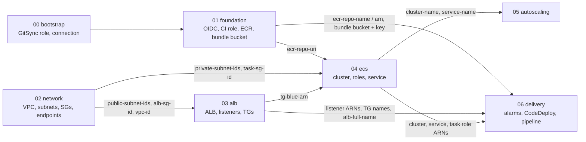

# AWS-onward-orders-app-infra

Infrastructure for the **Onward Logistics order system**. This repo holds the CloudFormation templates that build the whole AWS environment: the network, load balancer, containers, auto scaling and release pipeline. **CloudFormation GitSync** keeps AWS in step with this repo. When a template changes on `main`, its stack updates itself.

The application (Flask code, Dockerfile, CI workflows, and the deploy files `deploy/taskdef.yaml` and `deploy/appspec.yaml`) lives in a separate repo: **[AWS-onward-orders-app](https://github.com/Ndaziramiyep/AWS-onward-orders-app)**.

---

## Contents

1. [The problem we are solving](#1-the-problem-we-are-solving)
2. [The solution in one picture](#2-the-solution-in-one-picture)
3. [Why each choice was made](#3-why-each-choice-was-made)
4. [How this repo works: templates, deployment files, GitSync](#4-how-this-repo-works-templates-deployment-files-gitsync)
5. [The templates, one by one](#5-the-templates-one-by-one)
6. [How the stacks connect (exports)](#6-how-the-stacks-connect-exports)
7. [Real examples, step by step](#7-real-examples-step-by-step)
8. [Company standards and guardrails](#8-company-standards-and-guardrails)
9. [Deploy everything from AWS CloudShell](#9-deploy-everything-from-aws-cloudshell)
10. [Rebuild by hand](#10-rebuild-by-hand)
11. [Release, rollback, and idle](#11-release-rollback-and-idle)
12. [Cost in one table](#12-cost-in-one-table)
13. [Things a new engineer must know](#13-things-a-new-engineer-must-know)

---

## 1. The problem we are solving

**Onward Logistics** runs an online order system. Today, shipping a new version is risky:

- **Releases cause downtime.** Customers placing orders get errors while the app restarts, and peak days are the worst time for that.
- **Releases are manual.** Every engineer does the steps slightly differently, so environments drift apart.
- **Credentials leak.** Long-lived AWS access keys in laptops or CI secrets are a leading cause of cloud breaches.
- **Rollback is slow.** Undoing a bad release means another manual deploy, under pressure.
- **Idle environments still cost money.**

Each stakeholder stated what they need:

| Stakeholder | What they asked for |
|---|---|
| **CTO** | Merging code is the **only** manual step. **No outage** on release. **Fast rollback.** Infrastructure that a new engineer can read. |
| **Head of Security** | **No long-lived credentials.** **One** public entry point. The application has **no path to the internet**. |
| **Head of Operations** | Survive a **container failure** or the loss of a whole **Availability Zone**. **Scale without manual action.** |
| **Finance Lead** | **Idle environments cost nothing.** Explain the cost of VPC endpoints. |

The lab also sets hard rules:
- All infrastructure is **CloudFormation**, deployed through **GitSync**. Nothing is created in the console.
- ECS **Fargate** runs in **private subnets** behind an **internet-facing ALB**.
- There is **no NAT gateway**; AWS services are reached through **VPC endpoints**.
- **GitHub Actions** pushes to ECR with **OIDC**.
- **EventBridge → CodePipeline → CodeDeploy blue/green** releases the app.
- The infrastructure and the application live in **two separate repos**.
- There are **no inline IAM policies**.

---

## 2. The solution in one picture

```
 Developer merges to main (the ONLY manual step)
        │
        ▼
 ┌──────────────────────────┐   OIDC token (no keys)   ┌──────────────────────────────┐
 │ GitHub Actions (app repo)│ ───────────────────────► │ IAM role: github-actions-role │
 │  test → build → push     │ ◄─── 1-hour STS creds ── │ (ECR push + bundle upload,    │
 └────────────┬─────────────┘                          │  main only)                   │
              │                                        └──────────────────────────────┘
              │ 1. push :<sha> (immutable)
              │ 2. upload deploy bundle (taskdef.json + appspec.yaml zip) to S3
              │ 3. push :latest  (last, so the run it starts reads this commit's bundle)
              ▼
  ┌───────────┐  ┌───────────┐  "ECR Image Action PUSH latest"   ┌─────────────┐
  │ S3 bundle │  │    ECR    │ ────────────────────────────────► │ EventBridge │
  └─────┬─────┘  └───────────┘                                   └──────┬──────┘
        │ read only, never starts the pipeline                          ▼
        └──────────────────────────────►┌────────────────────────────────────────────────────┐
                                        │ CodePipeline                                       │
                                        │  Source: image URI (ECR) + deploy bundle (S3)      │
                                        │  Deploy: CodeDeploy blue/green, canary 10% → 100%  │
                                        └──────────────────────────┬─────────────────────────┘
                                                                   ▼
 Internet ──► ALB (public subnets, the only public thing)
               ├─ :80   production listener ──► blue  target group ─┐
               └─ :8080 test listener ───────► green target group ─┤
                                                                    ▼
          ┌──────────────── VPC 10.20.0.0/16, 2 Availability Zones ────────────────┐
          │  private-a (eu-west-1a)              private-b (eu-west-1b)            │
          │  Fargate task(s)                     Fargate task(s)                   │
          │  no public IP, no 0.0.0.0/0 route, no NAT gateway                      │
          │        │ HTTPS 443 only                                                │
          │        ▼                                                               │
          │  VPC endpoints: ecr.api, ecr.dkr, logs (interface) + s3 (gateway)      │
          └────────────────────────────────────────────────────────────────────────┘
```

**In one sentence:** a merge to `main` builds an image without any stored keys. The new image starts a pipeline, and the pipeline shifts traffic to the new version gradually, rolling back by itself if alarms fire. The app runs privately in two AZs and can talk only to AWS services, through endpoints.

Full diagram: [docs/architecture.md](docs/architecture.md). Costs: [docs/cost-analysis.md](docs/cost-analysis.md). Discovery report: [docs/discovery-report.pdf](docs/discovery-report.pdf).

---

## 3. Why each choice was made

| Problem | Applied solution | Why this one | Rejected alternative |
|---|---|---|---|
| Downtime on release | **CodeDeploy blue/green** on ECS with two target groups | A full new copy (green) starts beside the old one (blue). Traffic moves only after green is healthy. Switching back is instant because blue is still running. | ECS rolling update: old and new versions mix, there is no test listener, and rollback is a second rollout. |
| A bad release hurts all users | **Canary 10% for 5 minutes**, then 100% | At most 10% of traffic sees a bad version, for at most 5 minutes, while alarms watch it. | All-at-once: every user sees the bug. |
| Rollback must be fast | **Alarm-based auto rollback**, and blue kept for 5 minutes | Rollback is a traffic switch, not a redeploy. It takes seconds. | Manual redeploy of the old version |
| Leaked CI keys | **GitHub OIDC** + IAM role trusted for one repo on one branch | GitHub proves who it is with a signed token. AWS returns 1-hour credentials. There is nothing to steal or rotate. | IAM user access keys stored in GitHub secrets |
| One public entry point | **ALB** is the only internet-facing resource. Tasks have `AssignPublicIp: DISABLED`. | Customers reach only the ALB. The containers are unreachable from outside. | Tasks in public subnets |
| App must have no internet path | Private route tables with **no `0.0.0.0/0` route**, **no NAT**, and **VPC endpoints** for ECR, Logs and S3 | Tasks can still pull images and write logs, but cannot reach anything else. | NAT gateway: it gives the app internet access (forbidden) and its per-GB price is ~5× higher. |
| Survive task/AZ failure | **2 AZs**, **min 2 tasks**, ALB health checks, ECS replaces failed tasks | One task per AZ: losing one AZ still leaves a serving task. | Single AZ |
| Scale without humans | **Target tracking** on CPU 55% and memory 75%, 2 to 6 tasks | AWS adds or removes tasks to hold the target, like a thermostat. | Manual scaling or step scaling |
| Merge is the only manual step | **EventBridge** rule on the ECR push triggers **CodePipeline** | Event-driven: no polling, no button to press. | Pipeline polling, or a manual "Release" click |
| Infra must be reviewable and rebuildable | **CloudFormation + GitSync**, one stack per layer | Every change is a reviewed Git commit. AWS applies it automatically. The same repo rebuilds the same environment. | Console clicks or ad-hoc CLI scripts |
| No inline IAM policies | `AWS::IAM::ManagedPolicy` + `ManagedPolicyArns`, checked by CI | Policies are reusable, visible, versioned and auditable. | `Policies:` blocks inside roles |
| Idle costs money | `teardown`, or scale-to-zero schedule | Teardown removes everything billable. GitSync rebuilds it. | Leaving the environment always on |
| No servers to patch | **Fargate** | AWS runs the hosts; we only define tasks. | EC2 launch type |

---

## 4. How this repo works: templates, deployment files, GitSync

### Layout

```
AWS-onward-orders-app-infra/
├── bootstrap/00-gitsync-role.yaml      # The one stack GitSync cannot create (it makes GitSync's own role)
├── templates/                          # One CloudFormation template per layer, in build order
│   ├── 01-foundation.yaml              #   OIDC provider, GitHub Actions role, ECR repository, deploy bundle bucket
│   ├── 02-network.yaml                 #   VPC, subnets, route tables, security groups, VPC endpoints
│   ├── 03-alb.yaml                     #   ALB, prod + test listeners, blue + green target groups
│   ├── 04-ecs.yaml                     #   Cluster, logs, task roles, bootstrap task definition, service
│   ├── 05-autoscaling.yaml             #   Target tracking on CPU and memory, optional night schedule
│   └── 06-delivery.yaml                #   Alarms, CodeDeploy, CodePipeline, EventBridge rule
├── deployments/*.deployment.yaml       # GitSync file per stack: which template + parameters + tags
├── .github/workflows/lint.yaml         # CI: cfn-lint + inline-policy check + private-route check on every PR
├── cloudshell-deploy.sh                # One command that does everything from AWS CloudShell
└── docs/                               # Architecture diagram, cost analysis, discovery report
```

### Why six small stacks instead of one big template

- **Readable:** each file answers one question, such as "how does the network work?". A new engineer reads 100 to 400 lines, not 1,400.
- **Smaller blast radius:** changing auto-scaling numbers cannot touch the VPC.
- **Order is explicit:** the image must exist in ECR (01) before the service (04) can start.
- **Nested stacks don't fit GitSync:** GitSync does not upload child templates. Separate stacks that share values through `Export`/`ImportValue` are simpler.

### What a deployment file is

GitSync does not read a template directly. It reads a **deployment file** that says *which* template to deploy, *with which parameter values*, and *with which tags*. Example, [deployments/04-ecs.deployment.yaml](deployments/04-ecs.deployment.yaml):

```yaml
template-file-path: templates/04-ecs.yaml   # The template
parameters:                                 # Values for its Parameters
  ResourcePrefix: onward-orders-lab
  TaskCpu: "256"                            # 0.25 vCPU per task
  TaskMemory: "512"                         # 512 MiB per task
  DesiredCount: "2"                         # One task per AZ
  BootstrapImageTag: latest
tags:                                       # Company tags, put on the stack and every taggable resource
  Project: onward-orders
  Environment: lab
  Owner: patrick-ndaziramiye
  CostCenter: amalitech-training
  ManagedBy: cloudformation-gitsync
  Repository: AWS-onward-orders-app-infra
```

The template is the **recipe**; the deployment file is the **order slip** (how big, which name, which labels). The same template could build a `prod` environment with another deployment file that says `ResourcePrefix: onward-orders-prod` and `TaskCpu: "512"`.

### How GitSync behaves

```
git push to main
   │
   ▼
GitSync (CodeConnections) sees the commit
   │  Did this stack's template or deployment file change?
   ├── no  → nothing happens to that stack
   └── yes → creates a change set with the new template + parameters
             └─► executes it as onward-orders-lab-gitsync-role → stack updated
```

Three behaviours matter:
1. **GitSync only updates; it never creates.** If the stack doesn't exist, it fails with *"Stack does not exist"*. That's why [cloudshell-deploy.sh](cloudshell-deploy.sh) creates each missing stack **once** with `aws cloudformation deploy`, using the same template, parameters and tags read from its deployment file. It then attaches the GitSync configuration, and from that point on Git drives every change.
2. **Trigger = `FILE_CHANGE`.** A stack syncs only when *its own* template or deployment file changes. Editing `05-autoscaling.yaml` touches only the 05 stack.
3. **No cross-stack ordering.** GitSync syncs stacks independently, so the deploy script creates them one at a time and waits for each to finish before starting the next.

**Real example:** to raise peak capacity from 6 to 8 tasks, change one line in `deployments/05-autoscaling.deployment.yaml` (`MaxCapacity: "8"`), open a PR, and merge it. The CI lint runs on the PR. After the merge, GitSync updates only `onward-orders-lab-05-autoscaling` within a minute or two, and the console shows **MaxCapacity 8**. Nobody touches the console.

---

## 5. The templates, one by one

Every template takes `ResourcePrefix` (default `onward-orders-lab`). That parameter is how the company naming standard `<project>-<environment>-<resource>` is applied everywhere: `onward-orders-lab-alb`, `onward-orders-lab-cluster`, and so on.

### 00 — `bootstrap/00-gitsync-role.yaml` (deployed once, with the CLI)

**Problem:** GitSync needs an IAM role to deploy stacks, but that role cannot come from GitSync itself. It's a chicken-and-egg problem.

**Solution:** one small stack, deployed once by hand, that creates:

| Resource | What it does |
|---|---|
| `GitHubConnection` (optional) | The CodeConnections link to GitHub. It starts `PENDING` until someone clicks **Update pending connection** once in the console. That is the only console step in the whole lab. Skipped if `ExistingConnectionArn` is given. |
| `GitSyncPolicy` | Lets GitSync create and execute change sets and manage its own EventBridge rules (scoped with `events:ManagedBy`). |
| `GitSyncDeployPolicy` | What CloudFormation needs to build stacks 01 to 06. IAM actions are limited to roles and policies named `onward-orders-lab-*`, S3 to buckets named `onward-orders-lab-*`, and the OIDC action to GitHub's provider ARN. |
| `GitSyncRole` | Trusted by `cloudformation.sync.codeconnections.amazonaws.com` and `cloudformation.amazonaws.com`, only from this account (`aws:SourceAccount`). |

**Outputs:** `GitSyncRoleArn` and `ConnectionArn`. The setup script reads both.

> Honest trade-off for Q&A: the deploy role has broad service actions such as `ec2:*`, because it must create whole VPCs and load balancers. IAM, the dangerous part, is restricted to the project's own names, so this role cannot create an admin user or edit other teams' roles.

---

### 01 — `templates/01-foundation.yaml`: identity and image registry

**Problem:** GitHub Actions must push images and deploy files to AWS **without stored access keys**, and both need a private, safe home.

| Resource | Key settings | Why |
|---|---|---|
| `GitHubOidcProvider` | URL `token.actions.githubusercontent.com`, audience `sts.amazonaws.com` | Makes AWS trust tokens signed by GitHub. Only one is allowed per account, so `ExistingOidcProviderArn` can reuse an existing one. |
| `EcrRepository` | `ScanOnPush: true`, AES256, `IMMUTABLE_WITH_EXCLUSION` (only `latest` may move), lifecycle rules: expire untagged images after 1 day, keep the last 20 | Every image is scanned for vulnerabilities. A SHA tag such as `0cbc300` can never be overwritten, so it always means the same code, which makes rollback trustworthy. |
| `GitHubActionsPushPolicy` | `ecr:GetAuthorizationToken` + push actions **on this one repository only** | Least privilege: CI can push images and nothing else. It cannot delete images, read secrets or touch ECS. |
| `BundleBucket` (+ policy) | `onward-orders-lab-bundle-<account>-<region>`. Versioned, AES256, all public access blocked, HTTPS required. Old versions expire after 30 days (the newest 20 are always kept). | Holds the **deploy bundle**: a zip with `taskdef.json` and `appspec.yaml` at its root, uploaded by GitHub Actions. The pipeline's S3 source action requires versioning. It lives in 01, not 06, because the first image and bundle are pushed before stack 06 exists. |
| `GitHubActionsBundlePolicy` | `s3:PutObject` on **one key only**: `deploy/bundle.zip` (`BundleObjectKey` parameter) | CI can replace the bundle and nothing else. It cannot read, list or delete objects. |
| `GitHubActionsReleasePolicy` | Read-only `ListPipelineExecutions`, `GetPipelineExecution`, `GetPipelineState` on the release pipeline | Lets the app workflow wait for the AWS release and report its result. |
| `GitHubActionsRole` | Trust condition on `aud` and `sub`, max session 1 hour | Only the right repo on the right branch can assume it. |

**The trust condition, which is the core of "no keys":**

```yaml
Condition:
  StringEquals:
    token.actions.githubusercontent.com:aud: sts.amazonaws.com
  StringLike:
    token.actions.githubusercontent.com:sub:
      - repo:Ndaziramiyep/AWS-onward-orders-app:ref:refs/heads/main          # classic format
      - repo:Ndaziramiyep@*/AWS-onward-orders-app@*:ref:refs/heads/main      # newer immutable-ID format
```

**Real example:** when GitHub runs the workflow on `main`, it hands the job a signed token containing:
```
sub = repo:Ndaziramiyep@161883060/AWS-onward-orders-app@1461237572:ref:refs/heads/main
```
This matches the second pattern, so AWS returns credentials that expire within an hour. The same workflow on a feature branch gets `...:ref:refs/heads/feature-x`, which matches neither pattern, so it is **denied**. A fork or any other repo is also denied. GitHub → Settings → Secrets contains **no AWS secrets at all**.

**Exports:** `ecr-repo-name`, `ecr-repo-arn`, `ecr-repo-uri`, `github-actions-role-arn`, `bundle-bucket-name`, `bundle-bucket-arn`, `bundle-object-key`.

---

### 02 — `templates/02-network.yaml`: the private network

**Problem:** the containers must pull images and write logs, but must have **no internet path**, and must survive an AZ outage.

**Subnets and routes:**

| Subnet | CIDR | AZ | Route table | Who lives here |
|---|---|---|---|---|
| `public-a` | 10.20.0.0/24 | eu-west-1a | `public-rt`: `local` + `0.0.0.0/0 → IGW` | ALB node |
| `public-b` | 10.20.1.0/24 | eu-west-1b | `public-rt` | ALB node |
| `private-a` | 10.20.10.0/24 | eu-west-1a | `private-rt-a`: `local` + S3 prefix list **only** | Fargate tasks, endpoint ENIs |
| `private-b` | 10.20.11.0/24 | eu-west-1b | `private-rt-b`: `local` + S3 prefix list **only** | Fargate tasks, endpoint ENIs |

The private route tables have **no default route** and there is **no NAT gateway**. Even if the app tried to call `google.com`, the packet would have nowhere to go. `MapPublicIpOnLaunch: false` is set on every subnet, including the public ones, because nothing except the ALB should ever get a public IP.

**Security groups are chained by reference, not by IP:**

```
Internet ──80/443──► alb-sg ──8080──► task-sg ──443──► endpoint-sg   (ecr.api, ecr.dkr, logs)
                                         └──443──► S3 prefix list    (image layers via gateway endpoint)
```

| SG | Inbound | Outbound |
|---|---|---|
| `alb-sg` | 80, 443 from anywhere; 8080 (test listener) from **inside the VPC only** | 8080 to `task-sg` only |
| `task-sg` | 8080 from `alb-sg` only | 443 to `endpoint-sg` and the S3 prefix list only |
| `endpoint-sg` | 443 from `task-sg` only | none |

A detail worth explaining: a new security group allows **all outbound traffic by default**. Each SG here declares a dummy egress rule to `127.0.0.1/32`. That replaces the default allow-all, so the only real egress is what we add explicitly.

**VPC endpoints, which replace NAT:**

| Endpoint | Type | Used for |
|---|---|---|
| `ecr.api` | Interface (ENI in each private subnet) | Authenticate to ECR, look up the image manifest |
| `ecr.dkr` | Interface | Docker registry protocol |
| `logs` | Interface | Container stdout → CloudWatch Logs |
| `s3` | **Gateway** (free, a route in the private route tables) | ECR stores image layers in S3. The endpoint policy allows only `s3:GetObject` on `prod-eu-west-1-starport-layer-bucket`, which is ECR's own layer bucket. |

`PrivateDnsEnabled: true` means the normal name `api.ecr.eu-west-1.amazonaws.com` resolves to a **private IP inside our VPC**, so no app or ECS agent code needs to change.

**Real example, a task starting:** the ECS agent resolves `api.ecr.eu-west-1.amazonaws.com` → 10.20.10.x (the endpoint ENI). It goes out on 443 (`task-sg` → `endpoint-sg`, allowed) and gets the manifest. It then downloads the layers from S3 through the gateway endpoint (the prefix-list route, allowed by the endpoint policy). The container starts and its logs go through the `logs` endpoint. No packet ever leaves AWS's network.

**Exports:** VPC ID and CIDR, public and private subnet IDs, and the three SG IDs.

---

### 03 — `templates/03-alb.yaml`: the only public door

**Problem:** customers need one stable public address, traffic must only reach healthy tasks, and blue/green needs a place to put the new version **before** it gets live traffic.

| Resource | Key settings | Why |
|---|---|---|
| `LoadBalancer` | internet-facing, both public subnets, `drop_invalid_header_fields` on | The single public entry point, present in 2 AZs |
| `BlueTargetGroup`, `GreenTargetGroup` | `TargetType: ip` (required for Fargate `awsvpc`), health check `GET /health` every 10 s, 2 OK = healthy, 2 fails = unhealthy, deregistration delay 30 s | Two "slots". One holds the live version, the other the new one. |
| `ProductionListener` | :80 → **blue** (or :443 with TLS 1.3 policy if `CertificateArn` is set, with :80 redirecting) | Where customers go |
| `TestListener` | :8080 → **green** | CodeDeploy puts the new version here first. Only reachable from inside the VPC. |

**Real example, health checks:** if a task's `/health` starts returning 500, the ALB marks it unhealthy after 2 × 10 s = **~20 seconds** and stops sending it traffic. ECS then replaces it. Customers see no errors, because the other healthy task carries the traffic meanwhile.

**Important:** after the first release, CodeDeploy flips the listeners, so *production may point at green*. That's normal. "Blue" and "green" are just two slots that take turns being live.

**Exports:** ALB DNS name and full name, both listener ARNs, both target group ARNs, names and full names.

---

### 04 — `templates/04-ecs.yaml`: where the app runs

**Problem:** run the container with no servers to manage, privately, in both AZs, with minimal permissions, and let CodeDeploy (not CloudFormation) own releases.

| Resource | Key settings | Why |
|---|---|---|
| `Cluster` | Fargate only, Container Insights on | No EC2 to patch; CPU and memory metrics per task |
| `LogGroup` | `/ecs/onward-orders-lab`, 14-day retention | Logs are kept long enough to debug but don't grow forever, which saves cost |
| `TaskExecutionRole` | AWS-managed `AmazonECSTaskExecutionRolePolicy` | Used by the **ECS agent** to pull the image and write logs |
| `TaskRole` + `TaskPolicy` | A managed policy that only **denies** `iam:*`, `sts:AssumeRole` and `organizations:*` | Used by **the app code**. The app needs no AWS APIs, so it gets none, and the explicit Deny blocks escalation even if someone attaches more later. |
| `TaskDefinition` | 0.25 vCPU / 512 MiB, image `<ecr-uri>:latest`, port 8080 | The **bootstrap** version, used only to create the service |
| `Service` | `DeploymentController: CODE_DEPLOY`, `AssignPublicIp: DISABLED`, both private subnets, `task-sg`, blue target group, `DesiredCount: 2`, health check grace 60 s | Tasks spread over both AZs. CodeDeploy controls releases. |

**Two roles, two jobs (a common interview question):**
- *Execution role* = the **delivery driver**. It fetches the image and ships logs before and while the app runs.
- *Task role* = the **app's own badge**, for any AWS calls the code makes. Ours has none.

**Why `CODE_DEPLOY` as the controller:** with the default ECS controller, a new task definition triggers a rolling update. With `CODE_DEPLOY`, ECS refuses direct updates and waits for CodeDeploy to create a new *task set* in the other target group. That is what makes blue/green, canary and instant rollback possible.

**Container health check:** the Docker-level health check (the console's *Health status* column) is defined in the **app repo's `deploy/taskdef.yaml`**, not here: `python -c "urllib.request.urlopen('http://127.0.0.1:8080/health')"` every 30 s. This bootstrap definition has none, so freshly created tasks show *Unknown* until the first pipeline release replaces them; after that they show *Healthy*.

**Sizing:** 0.25 vCPU / 512 MiB is the smallest Fargate size. Gunicorn uses ~120 MiB. We scale **out** (more tasks) instead of **up** (bigger tasks), because more tasks also means more AZ redundancy.

**Exports:** cluster name, service name, both role ARNs, log group.

---

### 05 — `templates/05-autoscaling.yaml`: scale without humans

**Problem:** peak days need more capacity; quiet hours shouldn't pay for it; nobody should have to click anything.

| Resource | Settings |
|---|---|
| `ScalableTarget` | The service's `DesiredCount`, min **2**, max **6**. Optional schedule: 0 tasks at 19:00 and back to 2 at 07:00, Mon–Fri UTC. |
| `CpuScalingPolicy` | Keep average CPU at **55%** |
| `MemoryScalingPolicy` | Keep average memory at **75%** |
| Cooldowns | Scale **out** after 60 s (react fast to peaks), scale **in** after 300 s (avoid flapping) |

**How target tracking works, as an analogy:** it's a thermostat. You set the temperature (55% CPU), and AWS adds or removes tasks to keep it there. The two policies run together: AWS scales out if *either* metric is too high, and scales in only when *both* allow it.

**Real example:** 2 tasks are averaging **80% CPU** during a sale. Target tracking computes roughly `2 × 80 / 55 ≈ 2.9`, so it sets desired = **3**. One minute later, if load keeps rising, it goes to 4, and so on up to the cap of 6. When the sale ends and CPU drops to 20%, it waits 5 minutes, then removes tasks one step at a time, but **never below 2**, so one task per AZ always survives.

**Why min 2, max 6:** 2 is the HA floor (one per AZ). 6 is a cost ceiling sized for a peak of about 3× normal load, at ~$9/month per extra always-on task.

---

### 06 — `templates/06-delivery.yaml`: the release pipeline

**Problem:** a new image must go live **automatically**, **gradually**, and **undo itself** if it's bad.

| Resource | What it does |
|---|---|
| `ArtifactBucket` (+ policy) | Pipeline working files. Encrypted, versioned, all public access blocked, HTTPS required (`aws:SecureTransport`), expires after 30 days. |
| `ErrorAlarm` | Fires when the app returns ≥ 5 server errors in 1 minute |
| `BlueUnhealthyAlarm`, `GreenUnhealthyAlarm` | Fire when ≥ 1 target is unhealthy for 2 consecutive minutes |
| `CodeDeployApplication` + `DeploymentGroup` | `BLUE_GREEN` with traffic control; canary **10% for 5 min** then 100%; keeps blue **5 more min**; **auto rollback** on failure, alarm or manual stop; watches the 3 alarms |
| `PipelinePolicy` + `PipelineRole` | Least privilege: this artifact bucket, read of the deploy bundle object (bucket from 01), `DescribeImages` on this repo, this CodeDeploy app, register **and tag** task definitions of this family only, and `PassRole` of the two task roles to ECS only |
| `Pipeline` (V2, `QUEUED`) | **Source**: `Image` (ECR, tag `latest`) and `DeployBundle` (S3: bundle bucket and key imported from 01, `PollForSourceChanges: false`). **Deploy**: `CodeDeployToECS`, which reads `taskdef.json` and `appspec.yaml` from the root of the bundle. |
| `ImagePushRule` + `EventBridgeRole` | EventBridge: on *ECR Image Action PUSH SUCCESS* for repo `onward-orders-lab`, tag `latest`, start the pipeline. The role can do **only** `StartPipelineExecution` on this pipeline. |

**Why the pipeline reads two sources:** the image says *what* code to run; the task definition and AppSpec say *how* to run it (CPU, health check, port). The pipeline replaces `<IMAGE1_NAME>` in `taskdef.json` with the exact image URI and registers a new revision. CodeDeploy then deploys it according to `appspec.yaml`.

**Why the deploy files come from S3, not from this template or from GitHub:** they belong to the app, so they live in the app repo (`deploy/taskdef.yaml`, `deploy/appspec.yaml`) and this template never names or contains them. On every push to `main`, the app's `scripts/build-push.sh` converts `taskdef.yaml` to JSON (the CodeDeployToECS action reads only JSON), zips it with `appspec.yaml`, and uploads the zip to the bundle bucket **before** it pushes `:latest`. The pipeline run that the `:latest` push starts therefore reads the bundle from the same commit as the image. The pipeline needs no GitHub connection; only GitSync uses one.

**Why `PollForSourceChanges: false` on the bundle:** a push to the app repo already produces a new image, which triggers the pipeline through EventBridge. If the bundle upload also triggered it, every merge would release twice.

**Why `QUEUED` mode:** if two merges land a minute apart, the second release waits for the first instead of cancelling it mid-canary.

**Canary timeline for one release:**

```
t=0     green task set starts in private-a + private-b, registers in the idle target group
t≈1m    green healthy → production listener: 90% blue / 10% green
t≈1–6m  canary window: 3 alarms are watched; any alarm → instant rollback to 100% blue
t≈6m    100% green
t≈11m   blue terminated (the 5-minute rollback window is over)
```

---

## 6. How the stacks connect (exports)

Stacks never hard-code each other's IDs. Each one **exports** values named `onward-orders-lab-*` and later stacks **import** them. CloudFormation then *refuses* to delete a stack whose exports are still in use, which protects the build order.



| Order | Stack | Needs from earlier stacks |
|---|---|---|
| 00 | bootstrap | nothing |
| 01 | foundation | nothing |
| 02 | network | nothing |
| 03 | alb | 02: VPC, public subnets, ALB SG |
| ★ | **first image push** | 01: ECR, bundle bucket and CI role, because tasks can't start without an image |
| 04 | ecs | 01: ECR URI. 02: private subnets, task SG. 03: blue target group |
| 05 | autoscaling | 04: cluster and service |
| 06 | delivery | 01 (ECR, bundle bucket), 03, 04 |

**Create 01 → 06. Delete 06 → 01.**

---

## 7. Real examples, step by step

### Example A: a customer opens the website

1. The browser resolves `onward-orders-lab-alb-…eu-west-1.elb.amazonaws.com` to the ALB's public IPs, and the request reaches the ALB on port 80.
2. The production listener forwards it to the live target group, say blue.
3. The ALB picks a healthy task, for example `10.20.11.37` in eu-west-1b, and connects on 8080 (`alb-sg` → `task-sg`, allowed).
4. The Flask app renders the page, showing the task's AZ. Refresh a few times and you'll see both `eu-west-1a` and `eu-west-1b`, which is load balancing across AZs.
5. The task **cannot** open a connection to the internet, and the internet cannot open one to it. Only the ALB can.

### Example B: shipping a change (real commit `0cbc300`, "add container health check")

| Time | What happened | Where to see it |
|---|---|---|
| 0:00 | `git push` to `main` in the app repo | GitHub |
| 0:01 | Actions runs `pytest`, then gets OIDC credentials. No secret is involved. | Actions → build-and-push |
| 0:03 | Pushes `onward-orders-lab:0cbc300`, uploads the deploy bundle to `s3://onward-orders-lab-bundle-…/deploy/bundle.zip`, then pushes `:latest` (scan on push) | ECR → images; S3 → bundle bucket |
| 0:03 | ECR emits a PUSH event for `latest`, and EventBridge starts the pipeline (trigger: `CloudWatchEvent`) | CodePipeline → history |
| 0:04 | Source reads the image URI + the deploy bundle; Deploy registers a new task definition revision from its `taskdef.json` | ECS → task definitions |
| 0:05 | CodeDeploy starts green tasks in both AZs, waits for health, sends 10% of traffic | CodeDeploy → deployment |
| 0:10 | No alarm fired, so 100% goes to green; `/version` now returns `0cbc300` | Browser |
| 0:15 | Blue tasks terminated; the new tasks show **Health status: Healthy** | ECS → tasks |

The only human action was `git push`.

### Example C: a bad release rolls itself back

1. Set `FORCE_UNHEALTHY = True` in `app/settings.py` and push.
2. Green tasks start, but `/health` returns 500. The ALB marks them unhealthy within ~20 s.
3. `onward-orders-lab-tg-green-unhealthy` goes into ALARM after 2 minutes.
4. CodeDeploy sees the alarm, **stops the deployment and keeps or returns 100% of traffic to blue**.
5. Customers saw at most 10% errors, and only if traffic had already shifted. Blue never stopped.
6. Set it back to `False` and push again. The next release goes through normally.

### Example D: a container crashes, or a whole AZ fails

- `aws ecs stop-task --cluster onward-orders-lab-cluster --task <id>`: the ALB stops routing to it, the other AZ's task keeps serving, and ECS starts a replacement within about a minute.
- If eu-west-1a went down, the ALB node and task in eu-west-1b keep serving. Auto scaling and ECS put new tasks wherever capacity exists.

### Example E: rolling back to last week's version

Because SHA tags are immutable, `onward-orders-lab:234a874` is guaranteed to be the exact old code. In the app repo, open **Actions → rollback → Run workflow** on `main` and enter the commit, or run `./scripts/rollback.sh 234a874` locally. It:

1. Builds the deploy bundle from **that commit's** `deploy/taskdef.yaml` and `deploy/appspec.yaml` and uploads it to the bundle bucket, so the old image runs with its own settings.
2. Points `latest` at the old image (re-puts its manifest; no layers move). The push event starts a normal blue/green release, with the same canary and alarm rollback.
3. Waits for the release, like a normal ship.

Revert the bad commit on `main` too, or the next push ships it again.

### Example F: changing infrastructure

To give tasks more memory: edit `TaskMemory: "1024"` in `deployments/04-ecs.deployment.yaml`, then PR → CI lint → merge. GitSync updates only the 04 stack. (For the *running* app, change `memory` in the app repo's `deploy/taskdef.yaml` instead, because CodeDeploy owns the live task definition. See [section 14](#14-things-a-new-engineer-must-know).)

---

## 8. Company standards and guardrails

- **Naming:** `<project>-<environment>-<resource>`, for example `onward-orders-lab-alb`. It comes from the single `ResourcePrefix` parameter.
- **Tags:** every deployment file sets `Project`, `Environment`, `Owner`, `CostCenter`, `ManagedBy` and `Repository`. GitSync applies them to the stack, and CloudFormation propagates them to every taggable resource. Each resource also gets a `Name` tag. Finance can filter costs with `CostCenter=amalitech-training`.
- **IAM:** no inline policies. Every role uses `ManagedPolicyArns` with `AWS::IAM::ManagedPolicy` (customer-managed) or AWS-managed policies. Every service trust policy has `aws:SourceAccount`, which prevents the *confused deputy* problem.
- **CI on every PR** ([.github/workflows/lint.yaml](.github/workflows/lint.yaml)):
  1. `cfn-lint` validates every template against the CloudFormation spec.
  2. `grep` fails the build if `Policies:` or `AWS::IAM::Policy` appears anywhere.
  3. A Python check fails the build if any `AWS::EC2::Route` is added to a private route table.

So a PR that adds an inline policy or gives the private subnets a route to the internet (through an internet gateway or a NAT gateway) **fails before it can reach `main`**, and GitSync never sees it. After deployment, `bash cloudshell-deploy.sh verify` checks the live account for the same things: no NAT gateway, no `0.0.0.0/0` in private route tables, no inline policies.

---

## 9. Deploy everything from AWS CloudShell

```bash
git clone https://github.com/Ndaziramiyep/AWS-onward-orders-app-infra.git && cd AWS-onward-orders-app-infra
bash cloudshell-deploy.sh
```

The repos are public, so no token is needed. If you `export GITHUB_TOKEN=<PAT: repo, workflow>`, the script can also push commits and start workflows for you; without one, it tells you what to click.

What the script does, in order:
1. Deploys `00-bootstrap` and waits for the one-time GitHub connection authorization.
2. Checks that account-specific values (account ID, region, connection ARN, S3 prefix list) are correct in both repos.
3. For **01 → 03**: creates each missing stack once, attaches GitSync, waits for it.
4. Waits for GitHub Actions to push the first image (click **Run workflow** on build-and-push if asked).
5. Same as step 3 for **04 → 06**.
6. Verifies: ALB returns 200 on `/health`, no NAT, no default route in private subnets, no inline policies, OIDC role present, service stable.

Every step is **idempotent**. If CloudShell times out, run the same command again and it continues where it stopped.

| Command | Purpose |
|---|---|
| `bash cloudshell-deploy.sh status` | Stack status, ALB URL, last pipeline run |
| `bash cloudshell-deploy.sh publish` | Re-apply account values to both repos |
| `bash cloudshell-deploy.sh verify` | Re-run the security and HA checks |
| `bash cloudshell-deploy.sh teardown` | Delete stacks 06 → 01 (idle = no cost); `deploy` rebuilds them |

Settings such as `AWS_REGION`, `PREFIX`, `INFRA_REPO`, `APP_REPO` and `CONNECTION_ARN` are at the top of [cloudshell-deploy.sh](cloudshell-deploy.sh).

---

## 10. Rebuild by hand

Region `eu-west-1`, account `648637468459`, from the repo root with admin credentials.

1. **Bootstrap (once):**
   ```bash
   aws cloudformation deploy --region eu-west-1 \
     --stack-name onward-orders-lab-00-bootstrap \
     --template-file bootstrap/00-gitsync-role.yaml \
     --capabilities CAPABILITY_NAMED_IAM \
     --parameter-overrides ExistingConnectionArn=arn:aws:codeconnections:eu-west-1:648637468459:connection/387b1181-82b8-4718-b249-b81bfe30c3c0 \
     --tags Project=onward-orders Environment=lab Owner=patrick-ndaziramiye CostCenter=amalitech-training ManagedBy=cloudformation Repository=AWS-onward-orders-app-infra
   ```
   With `ExistingConnectionArn` empty, a new connection is created in `PENDING`. Open **Developer Tools → Settings → Connections → Update pending connection**.
2. **Foundation, network, ALB:** for each of `01-foundation`, `02-network`, `03-alb`, in order: create the stack once with `aws cloudformation deploy` using the template, parameters and tags in its `deployments/<name>.deployment.yaml`, then attach GitSync with `aws codeconnections create-sync-configuration --sync-type CFN_STACK_SYNC --config-file deployments/<name>.deployment.yaml ...`, and wait for `CREATE_COMPLETE`.
3. **First image:** push to `main` in the app repo, or run its workflow manually.
4. **ECS, autoscaling, delivery:** same as step 2 for `04-ecs`, `05-autoscaling`, `06-delivery`.
5. Open the `LoadBalancerDnsName` output of the `03-alb` stack.

The first image push happens before stack 06 exists, so it doesn't trigger a pipeline. The service runs that image from the bootstrap task definition. To prove the pipeline end to end immediately: `aws codepipeline start-pipeline-execution --name onward-orders-lab-pipeline`.

---

## 11. Release, rollback, and idle

- **Release:** merge to `main` in the app repo. Nothing else. The app workflow's `release` job runs `scripts/wait-for-release.sh`, so the GitHub check stays yellow during the canary and the rollback window and turns green only when the pipeline run for that image succeeds (red if CodeDeploy rolls back). During the canary about 10% of users already see the new version; that is the canary working, not a leak.
- **Automatic rollback:** if the 5XX alarm or either unhealthy-host alarm fires, or the deployment fails, CodeDeploy returns traffic to the old tasks.
- **Manual rollback during a release:** `aws deploy stop-deployment --deployment-id <id> --auto-rollback-enabled`, or **Stop and roll back** in the CodeDeploy console.
- **Roll back after a release finished:** run the app repo's **rollback** workflow with an older commit; it uploads that commit's deploy bundle and re-tags its image as `latest` ([Example E](#example-e-rolling-back-to-last-weeks-version)).
- **Idle:** `bash cloudshell-deploy.sh teardown` removes everything billable (GitSync configurations first, then stacks 06 → 01, emptying the artifact bucket before 06 and the bundle bucket before 01). `bash cloudshell-deploy.sh deploy` rebuilds it. For nights only, set `EnableOfficeHoursSchedule: "true"` in `deployments/05-autoscaling.deployment.yaml`. That saves Fargate only; the ALB and endpoints still bill.

---

## 12. Cost in one table

eu-west-1, always on, 2 tasks, approximate list prices (details: [docs/cost-analysis.md](docs/cost-analysis.md)).

| Component | ~ per month |
|---|---|
| Fargate, 2 × (0.25 vCPU, 0.5 GB) | $18 |
| ALB | $24 |
| 3 interface endpoints × 2 AZs | $48 |
| S3 gateway endpoint | $0 |
| ECR, CloudWatch, CodePipeline, CodeDeploy | ~$3 |
| **Total** | **~$94** |
| After `teardown` | **~$0** |

**Endpoints vs NAT, for Finance:** 1 NAT gateway costs ~$35/month and an HA pair ~$70; our endpoints cost ~$48. NAT is therefore cheaper than endpoints only in the non-HA single-gateway case, and **it fails the security requirement** because it gives the app an internet path. Endpoints also process data at $0.01/GB, against $0.048/GB through NAT.

---

## 13. Things a new engineer must know

1. **CodeDeploy owns the service after creation.** Don't change `TaskDefinition` or `LoadBalancers` in `04-ecs.yaml`, or the listener default actions in `03-alb.yaml`. After a release, production may point at *green*, and a stack update would fight CodeDeploy. App and runtime changes ship through the app repo (`deploy/taskdef.yaml`, delivered in the S3 deploy bundle).
2. **Stack order matters.** Create 01 → 06, delete 06 → 01. Exports block wrong-order deletes.
3. **Tasks stuck in PROVISIONING, or `CannotPullContainerError`,** almost always mean a missing endpoint (`ecr.api`, `ecr.dkr`, `logs`, S3 gateway) or `endpoint-sg` not allowing 443 from `task-sg`.
4. **ECR tags:** SHA tags are immutable. Only `latest` can move, because `latest` is what the pipeline watches.
5. **Run `cloudshell-deploy.sh` from a clone of this repo**, because it reads `templates/`, `bootstrap/` and `deployments/` next to it.
